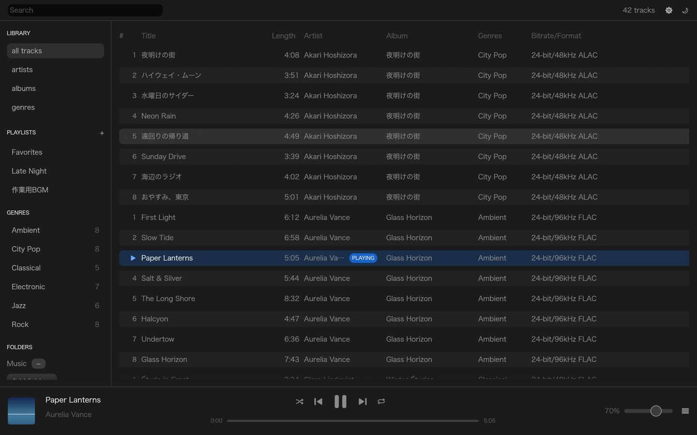
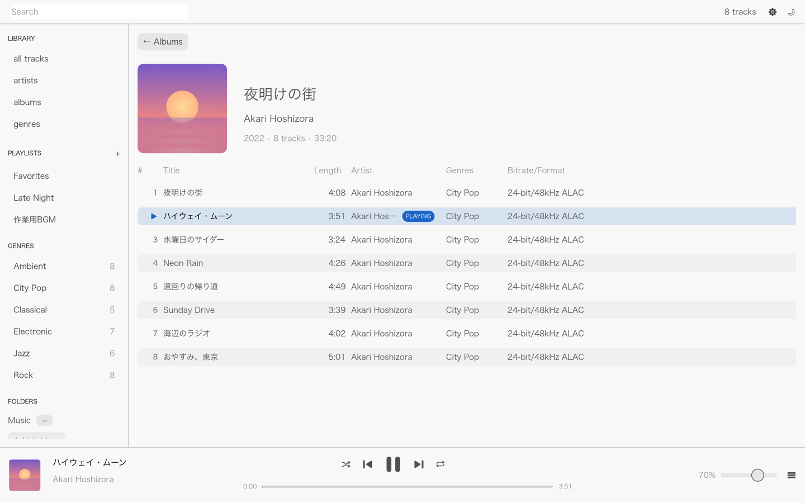

# Maplay

A lightweight, native music player for macOS, written entirely in Rust.

English | [日本語](README.ja.md)

Maplay plays the files you already have — no importing, no copying. Point it at your
music folders and it keeps a fast, searchable library in sync. Audio goes straight to
Core Audio, with gapless playback and an optional bit-perfect mode.



<sub>Screenshots use a demo library of fictional artists with generated cover art.</sub>

> **Status:** early (0.1.0). It is developed for daily personal use on Apple Silicon Macs
> and has been tested on a single machine. Expect rough edges. There are no binary
> releases yet; build it from source.

## Features

- **Formats:** FLAC, ALAC, MP3, AAC (including HE-AAC), WAV, AIFF, Ogg Vorbis
- **Gapless playback**, including AAC/MP3 encoder delay and padding
- **Bit-perfect mode:** the output device's sample rate follows each track and the
  software volume is bypassed. Optional exclusive access (hog mode). Not offered on
  Bluetooth or AirPlay outputs, where it cannot work.
- **Output device selection**, with automatic fallback when a device is unplugged
- **Library from folders you choose** — files are never copied or moved. Changes are
  picked up automatically (FSEvents); rescans are incremental
- **Browse** by album, artist, genre or all tracks, with instant search; lists are
  virtualized so tens of thousands of tracks stay smooth
- **Playlists** stored as plain `.m3u8` files, independent of the library database
- **Queue** ("Up Next"), shuffle and repeat
- **Album artwork** from embedded tags or `cover.jpg`/`folder.png`, cached as thumbnails
- **Media keys and Now Playing** integration
- **Light, dark or system theme**; Japanese and other CJK text render correctly

## Requirements

- macOS 14 or later, Apple Silicon (arm64)
- A recent stable Rust toolchain (edition 2024; developed with Rust 1.98)

## Build and run

```sh
cargo run --release -p maplay-app
```

To build a proper `Maplay.app` (icon, Info.plist, ad-hoc signature) and install it:

```sh
scripts/bundle.sh              # builds dist/Maplay.app
scripts/bundle.sh --install    # ...and copies it to /Applications
```

The app is signed ad hoc, which is enough to run a copy you built yourself. Distributing
it to other people would need a Developer ID signature and notarization.

## Using it

Use **Add folder…** in the sidebar to choose a music folder. Double-click a track to play.



| Key | Action |
| --- | --- |
| Space | Play / pause |
| ⌘→ / ⌘← | Next / previous track |
| ⌘F | Focus search (Esc clears it) |
| Media keys | Play / pause, next, previous |

Right-click a track to add it to a playlist. The ⚙ menu in the toolbar has bit-perfect
mode, exclusive access and the output device; the button beside it cycles the theme.

### Where your data lives

Everything is under `~/Library/Application Support/Maplay/`:

| Path | Contents |
| --- | --- |
| `library.db` | Library cache (SQLite). Safe to delete — it is rebuilt by rescanning |
| `playlists/*.m3u8` | Your playlists |
| `settings.txt` | Theme, bit-perfect, exclusive access and output device |
| `artwork/` | Thumbnail cache. Safe to delete |

Tags in the files are the source of truth; Maplay never writes to your music files.

## Development

```sh
cargo fmt --all
cargo clippy --workspace --all-targets -- -D warnings
cargo test --workspace
```

The workspace has two crates:

- `core/` (`maplay-core`) — everything that is not UI: Core Audio output and device
  handling (the only place with `unsafe`, wrapped in safe APIs), decoding, the playback
  engine, library scanning and queries, playlists, artwork and settings
- `app/` (`maplay-app`, binary `maplay`) — the egui/eframe user interface

How it fits together: audio is decoded with AudioToolbox (`ExtAudioFile`), except Ogg
Vorbis which uses [symphonia](https://github.com/pdeljanov/Symphonia). A decode thread
feeds a lock-free ring buffer ([rtrb](https://github.com/mgeier/rtrb)) that the Core
Audio render callback drains, and nothing in that callback locks, allocates or does I/O.
The library is a SQLite cache of tags read with [lofty](https://github.com/Serial-ATA/lofty-rs).

### Test audio

Tests that need audio files skip themselves when `testdata/` is absent. To generate it
(requires `sox`, `lame` and macOS `afconvert`):

```sh
brew install sox lame
scripts/gen-test-audio.sh
```

Some tests open the real output device, always muted. The bit-perfect test briefly
switches the default device's sample rate and restores it afterwards. They skip when no
device exists.

### Screenshots for development

With `MAPLAY_SCREENSHOT=<file.png>` set, the app renders one frame to that file and exits.
Combine it with `MAPLAY_THEME=light|dark`, `MAPLAY_NAV=albums|artists|genres|album`,
`MAPLAY_PLAY=<row>` (plays muted) and `MAPLAY_SELECT=<row>` to capture a specific state;
`MAPLAY_WINDOW=1440x900` sets the window size and `MAPLAY_VOLUME=<0-100>` the playback
volume (keep it at the default 0 unless the library is silent). It needs an unlocked screen.

### Documents

- [`docs/spec.md`](docs/spec.md) — the design and ground rules (in Japanese)
- [`docs/gui-mockup.webp`](docs/gui-mockup.webp) — the UI mockup the interface follows

## Not planned

CUE sheets, network shares, DSD/APE/WMA, tag editing, EQ, crossfade, ReplayGain, lyrics
and scrobbling. Opus may come later.

## License

Licensed under either of

- Apache License, Version 2.0 ([LICENSE-APACHE](LICENSE-APACHE))
- MIT license ([LICENSE-MIT](LICENSE-MIT))

at your option. Unless you explicitly state otherwise, any contribution intentionally
submitted for inclusion in this project, as defined in the Apache-2.0 license, shall be
dual licensed as above, without any additional terms or conditions.
